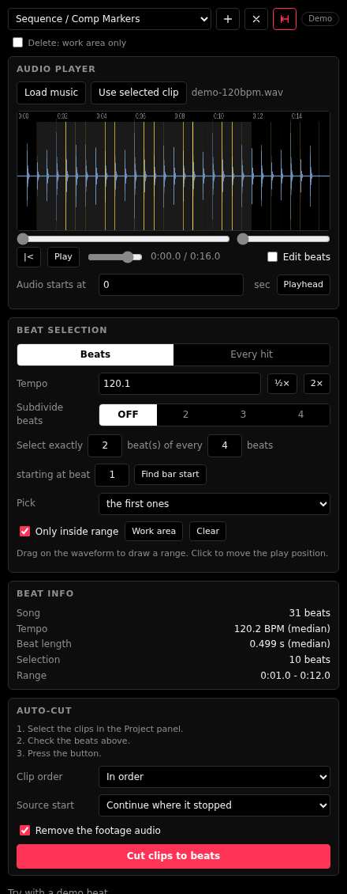

# Beat Marker Panel

A free panel for **Adobe After Effects** and **Premiere Pro**. Pick a music file, the panel finds the beats and drops a marker on every one. Cut your video to the rhythm without tapping the `M` key along to the song.

**Version 1.1.2.** The layout follows the workflow of dedicated beat-marker tools: an audio player with a big zoomable waveform on top, a transport row, a Beat selection box, a Beat info box, a marker-type dropdown and a delete button with a work-area option. No branding is copied.

- **Auto-cut (headline feature):** select clips in the Project panel and press one button. The clips are placed back to back on the beats, one clip per gap between two selected beats. Premiere Pro first, After Effects too.
- **Use selected clip:** reads the audio clip or layer you selected in the timeline, analyses only the part of the file that clip shows, and offsets the markers to where the clip sits.
- **Clip / Layer markers** (on the clip in Premiere, on the layer in After Effects) or **Sequence / Comp markers**.
- **Delete** removes only this panel's "Beat N" markers. Shift-click (or tick "Delete: work area only") to limit it to the work area.
- **Beats mode** (tempo plus a dynamic-programming beat tracker) and **Every hit mode** (with Sensitivity).
- **Beat selection:** subdivide beats (OFF, 2, 3, 4), "select exactly N beats of every M beats", starting at beat S, picked first / evenly / randomly, **Find bar start**, and limit to a range (drag on the waveform, or use the work area).
- **Edit beats:** tick "Edit beats", then click the waveform to add a beat, click a beat to remove it, drag a beat to move it.
- **Beat info:** beats in the song, median tempo and beat length, how many beats are selected.
- Zoom and scroll strip, click to move the play position, play with volume, space bar plays and stops.
- **MP3, WAV and most audio files load.** If the app's own audio engine can not read an MP3, the panel uses a built-in pure JavaScript MP3 decoder (no download, works offline). Decoding takes about 1 second per 10 seconds of music in that case.
- MIT licensed, no account, no internet, nothing leaves your computer.



The panel is responsive: wider than about 560 px it puts Beat info and Auto-cut next to Beat selection.

## Install (no coding needed)

You need Premiere Pro 2020 or newer and/or After Effects 2020 or newer. The panel is a CEP extension.

1. Click **Code > Download ZIP** on this page and unzip it.
2. **Windows:** double-click `install/install-win.bat`.
   **Mac:** open Terminal, type `bash ` (with a space), drag `install/install-mac.sh` into the window, press Enter.
3. Fully quit and reopen Premiere Pro / After Effects.
4. Open **Window > Extensions > Beat Markers** (in After Effects it may be under **Window > Extensions (Legacy)**).

The installer copies the panel to Adobe's per-user extensions folder and turns on "PlayerDebugMode", which Adobe requires for any panel that is not a signed `.zxp`. To uninstall, delete the folder `com.krshnaprsad.beatmarkerpanel` from:

- Windows: `%APPDATA%\Adobe\CEP\extensions\`
- Mac: `~/Library/Application Support/Adobe/CEP/extensions/`

## How to use

**Markers from a clip in your timeline (easiest)**

1. Put the song on an audio track (Premiere) or as a layer (After Effects) and click it so it is selected.
2. In the panel, press **Use selected clip**. The waveform shows the part of the song your clip uses.
3. Check **Tempo**. If the yellow lines land on every other beat, or twice per beat, press the half or double button.
4. Choose what to mark: **Beat selection > Select exactly 1 beat of every 4 beats** gives one marker per bar, and **Find bar start** picks which beat starts the bar.
5. Pick **Sequence / Comp Markers** or **Clip / Layer Markers** in the dropdown and press **+**.

**Markers from a music file**: press **Load music** (or drag a file onto it), then set **Audio starts at** to where the song begins in your timeline (or press **Playhead**).

**Auto-cut**

1. Get your song's beats on screen as above, and select the beats you want to cut on (for example 1 of every 2).
2. In the **Project panel**, select the clips to cut with (not the timeline). Several clips, or a bin.
3. Press **Cut clips to beats** (or the red icon at the top).
4. Premiere puts the cuts on a **new empty video track above everything**, so your timeline is not touched. Delete that track to undo. After Effects adds layers in one undo step.
5. **Clip order** is in order or random. **Source start** is "continue where it stopped" (each clip carries on from where its last piece ended) or "always from the start".

## Test steps (what to check first)

Each step says what you should see. If something differs, the panel prints a message. Please send me that text.

1. **Use selected clip.** Select your song clip, press the button. Expect the waveform and the name. If it says it cannot read the file, the message includes the path it tried.
2. **Sequence markers.** Press +. Expect "Beat N" markers on the sequence ruler at the yellow lines.
3. **Clip markers (Premiere).** Switch the dropdown to Clip / Layer Markers, press +. Open the song clip in the Source monitor: the markers are on the source clip, so they show wherever you use that source. Trimmed clips should still match the music.
4. **Layer markers (After Effects).** Same, expect markers on the selected layer.
5. **Delete.** Press the X. Only "Beat N" markers go. Set a work area, shift-click X: only markers inside it go.
6. **Range and work area.** Press **Work area** in Beat selection. Only beats inside it stay bright.
7. **Auto-cut.** Select 3 or 4 video clips in the Project panel, select about 8 beats, press Cut clips to beats. Expect clips on a new top video track (Premiere) or new layers (After Effects), each starting on a beat, with no gaps. Scrub the cut points against the markers.
8. Try it with your own song at the start of the sequence, and at a later position in the timeline.

## Known limits

- Auto-cut uses each clip's video from its start (or where it stopped). Speed changes, nested sequences and still images are not handled specially. Stills are given any length.
- In Premiere, clip markers belong to the source file. Two clips of the same song share them.
- Auto-cut removes the footage's own audio only if "Remove the footage audio" is ticked, and only the audio of the clips it placed.

## How it works

Everything is analysed inside the panel, in JavaScript. The host (After Effects / Premiere) only receives a list of times and writes the markers.

1. The file is decoded to audio samples (the built-in Web Audio decoder, or a small WAV decoder as a fallback).
2. [`js/detect.js`](js/detect.js) takes a short-time Fourier transform and measures *spectral flux*: how much new energy shows up in each 12 ms step. Drum hits and note starts spike.
3. **Tempo:** the spikes are normalised against their surroundings and autocorrelated. Peaks at T, 2T and T/2 support each other, a soft preference for 118 BPM breaks ties, and the result is refined to a fraction of a BPM.
4. **Beat grid:** a dynamic-programming tracker (Ellis, 2007) picks the beats that sit on strong spikes while staying about one period apart. That gives a steady grid that survives missing hits and swing. Each beat is then snapped to the nearest spike.
5. **Bars:** for "every 4th beat" the panel tries each of the 4 starting points and keeps the one with the strongest low-frequency (kick and bass) hits.
6. **Every hit mode** skips the tempo step: an adaptive threshold on the spikes, with a minimum gap between hits (about 380 ms at the lowest sensitivity, 100 ms at the highest).

## Checked and not checked

I could not run After Effects or Premiere while building this, so it was checked this way:

- **Beat tracking accuracy** on generated music with known beat positions (`node tests/accuracy.test.js`). The test songs have kick, snare, hats and bass. A beat counts as found if it is within 70 ms of the true one. Results:

```
70 BPM straight            tempo   69.9  F 0.989
90 BPM straight            tempo   90.2  F 0.992
100 BPM swung 62%          tempo   99.7  F 0.992
120 BPM straight           tempo  120.1  F 0.994
128 BPM swung 66%          tempo  128.6  F 0.994
140 BPM straight           tempo  139.8  F 0.995
150 BPM, no hats           tempo  152.0  F 0.995
174 BPM straight           tempo  172.9  F 0.991
110 BPM, loud noise        tempo  110.0  F 1.000
120 BPM, tempo drifting 4% tempo  116.7  F 0.994
95 BPM, only a kick on 1   tempo   95.3  F 1.000
mean F 0.994, bar starts F 1.000
```

  These are clean, synthetic songs. Real music is harder: heavy compression, live drummers and long ambient parts will do worse. That is what the Tempo box and the half and double buttons are for.
- Every-hit detection and WAV decoding: `node tests/detect.test.js`.
- The marker code in `jsx/host.jsx` runs against mock After Effects and Premiere objects: `node tests/host.test.js`. It also parses as old ES3 ExtendScript.
- The panel runs in desktop Chrome (screenshot above), and decoding a generated WAV and MP3 works there.

Not verified, because I could not run Adobe apps: the Premiere and After Effects calls for selection, clip and layer markers, the work area, the Project panel selection, and auto-cut placement (the host script is checked against mock objects only, `node tests/host.test.js`). These parts check every step and stop with a plain message, but expect that some of them need a fix after your first test. Also not verified: decoding inside Adobe's own embedded browser. WAV and MP3 always work (MP3 falls back to the built-in decoder, tested against ffmpeg's decode with a correlation of 1.000 on 32, 44.1 and 48 kHz, mono and stereo, CBR and VBR). AAC/M4A and other compressed formats depend on the codecs in your version of the app; if you see "could not be decoded", use an MP3 or WAV. Also not verified: the exact look of the markers in the apps.

If something fails, the panel shows the error text. Open an issue with that text and your app version.

## Roadmap (not in this version)

- Coloured markers, separate marker types for beats, bars and hits.
- Tempo maps for songs that change tempo, and a "nudge all markers" control.
- Auto-cut with speed ramps, transitions and audio-driven effects.
- AAC/M4A decoder fallback.

## Files

```
index.html, css/        the panel
js/detect.js            tempo, beat tracking and hit detection (also used by the tests)
js/wav.js               WAV decoder fallback
js/mp3.js               MP3 decoder fallback (wraps the bundled js-mp3)
js/js-mp3.vendor.js     js-mp3 decoder, MIT (see THIRD-PARTY-LICENSES.md)
js/select.js            subdivide, N of M, manual edits, range
js/autocut.js           plans which clip fills which gap
js/main.js              panel logic
js/cep-bridge.js        talks to the host app
jsx/host.jsx            ExtendScript: markers, selection, auto-cut
tests/                  node tests (accuracy, detection, host mocks)
install/                installers for Windows and Mac
```

## License

MIT. The Zero3 Creatives logo in the panel header belongs to its owner and is not covered by the MIT license. The bundled MP3 decoder is also MIT (a port of go-mp3, Apache-2.0, from the public-domain PDMP3). See [THIRD-PARTY-LICENSES.md](THIRD-PARTY-LICENSES.md).
